<div align="center">

# whatbroke

**Diff your AI agent's behavior between two runs.**

[](https://www.npmjs.com/package/whatbroke-cli) [](LICENSE)

[English](README.md) · [简体中文](readme/README.zh-CN.md) · [日本語](readme/README.ja.md) · [한국어](readme/README.ko.md) · [Español](readme/README.es.md) · [Português](readme/README.pt-BR.md) · [Français](readme/README.fr.md) · [Deutsch](readme/README.de.md) · [Русский](readme/README.ru.md) · [हिन्दी](readme/README.hi.md)

</div>

Swap a model, tweak a prompt, bump a framework version, then run `whatbroke` and see exactly what changed: which tool calls disappeared, which arguments drifted, where cost and latency moved, and which outputs flipped.

Text diffs can't see this. Your agent can say "your subscription is cancelled" while silently skipping the `cancel_subscription` call. The words look fine. The behavior broke.



That's a real diff from swapping to a 3x smaller model, recorded on a laptop with ollama. The replies kept passing the vibe check while the model started sending its tool's own JSON schema as the tool arguments and skipping the actual cancellation call.

For the full story and the commands to reproduce it, see the case study: [what a 3x smaller model changed in a tool-calling agent](docs/findings/llama32-3b-vs-1b.md). There's a second one on swapping vendors at the same size: [a same-size vendor swap changed more than the 3x downgrade](docs/findings/llama32-3b-vs-qwen25-3b.md), and a third on upgrading a generation: [the model that fixed the fake IDs also stopped issuing refunds](docs/findings/qwen25-3b-vs-qwen3-4b-instruct.md).

The fourth one changes no model at all. Same weights, same prompts, same machine, only the path the request takes: [the proxy that silently turned an agent into a chatbot](docs/findings/litellm-ollama-streaming.md). One LiteLLM route with streaming on dropped every tool call in every scenario, returned HTTP 200 and `finish_reason: "stop"`, and printed the tool call as prose to the customer.

If you're wondering how this fits next to promptfoo, LangSmith, or your eval suite: [when to use what](docs/when-to-use-what.md).

Swapping your agent to a model that came out this week? Start here: [the model swap checklist](docs/model-swap-checklist.md).

## Install

```
npm install -g whatbroke-cli
```

Or run it directly:

```
npx whatbroke-cli diff before.jsonl after.jsonl
```

Try it right now with the bundled example traces:

```
git clone https://github.com/arthi-arumugam-git/whatbroke
cd whatbroke && npm install && npm run build
node dist/cli.js diff examples/support-agent-gpt4o.jsonl examples/support-agent-gpt5mini.jsonl
```

## How it works

1. Record a trace of your agent doing its job (a plain JSONL file, one event per line).
2. Change something. Model, prompt, framework version, tool descriptions, anything.
3. Record a trace of the new version doing the same job.
4. `whatbroke diff old.jsonl new.jsonl`

whatbroke aligns runs by id, aligns tool calls within each run, and reports:

| Finding | Severity |
|---|---|
| Run started failing, tool call dropped, tool now errors, output gone, run missing | breaking |
| Tool args changed, new tool calls, tools reordered, output changed, latency or cost regression | changed |
| Model changed, large token swings, run now succeeds | info |

Exit code is 1 when something breaking shows up, so you can put it straight into CI:

```yaml
- run: node run-agent-suite.js --out traces/current.jsonl
- run: npx whatbroke-cli diff traces/baseline.jsonl traces/current.jsonl --md >> "$GITHUB_STEP_SUMMARY"
```

`--fail-on changed` if you want stricter gates, `--fail-on never` if you just want the report.

## Flaky agents

Agents don't do the same thing twice, so a single before/after comparison can blame the change for noise the agent was already making. Record each scenario a few times and suffix the run ids:

```
refund-flow#1, refund-flow#2, refund-flow#3
```

whatbroke notices the suffixes, compares every before sample against every after sample, and puts a rate on each finding:

```
! issue_refund called with different args (amount) (6/9 run pairs)
```

Anything that also flaps between two *baseline* samples gets demoted to flaky info, because your agent behaved that way before the change too. Breaking findings that show up in under half the pairs soften to warnings. What's left is signal.

## Recording traces

The trace format is deliberately boring: JSONL you can write from any language in ten minutes.

```jsonl
{"type":"run_start","run":"refund-flow","meta":{"model":"gpt-4o"}}
{"type":"llm_call","run":"refund-flow","model":"gpt-4o","latency_ms":900,"tokens":{"input":512,"output":128},"cost_usd":0.004}
{"type":"tool_call","run":"refund-flow","name":"lookup_order","args":{"order_id":"A-1042"}}
{"type":"output","run":"refund-flow","content":"Refund issued."}
{"type":"run_end","run":"refund-flow","status":"ok"}
```

The fastest way to get one is the proxy. Zero code changes, any language:

```
whatbroke record --out traces/current.jsonl
```

Then point your agent at it and run it exactly as you always do:

```
OPENAI_BASE_URL=http://127.0.0.1:4141/v1 node my-agent.js
# or
ANTHROPIC_BASE_URL=http://127.0.0.1:4141 node my-agent.js
```

Every LLM call, tool call, and final answer lands in the trace. Streaming works, responses pass through untouched. If you drive several scenarios, send an `x-whatbroke-run` header per request to name the runs.

If you're in Node, the SDK wraps your existing client and records everything automatically:

```ts
import { Recorder } from "whatbroke-cli";
import OpenAI from "openai";

const rec = new Recorder({ file: "traces/current.jsonl", run: "refund-flow" });
const openai = rec.wrapOpenAI(new OpenAI());

// use openai exactly as before; llm calls and tool calls are captured
await runMyAgent(openai);

rec.output(finalAnswer);
rec.end("ok");
```

`rec.wrapAnthropic(client)` does the same for the Anthropic SDK. For everything else there's `rec.llmCall()`, `rec.toolCall()`, `rec.output()`, `rec.end()`, or just write the JSONL yourself.

In Python it's the same shape (`pip install whatbroke-recorder`, zero dependencies):

```python
from whatbroke import Recorder
from openai import OpenAI

rec = Recorder("traces/current.jsonl", run="refund-flow")
client = rec.wrap_openai(OpenAI())

run_my_agent(client)  # llm calls and tool calls are captured

rec.output(final_answer)
rec.end("ok")
```

`rec.wrap_anthropic(client)` works too, sync and async clients both. Traces recorded from Python, Node, and the proxy all diff against each other.

## Import existing traces

Already tracing your agent? `whatbroke import` converts what you have into diffable JSONL, no re-recording needed:

```
whatbroke import traces-export.json
whatbroke diff baseline.whatbroke.jsonl current.whatbroke.jsonl
```

The format is detected from the file. `--format otel|langfuse|langsmith` forces it, `--run <name>` sets the run name, `-o` picks the output path. The import prints what the source didn't carry (cost, tool args) so you know which findings can't show up.

### OpenTelemetry

Feed it an OTLP JSON span export, like what the collector's `file` exporter writes. Anything emitting the GenAI semantic conventions works, including Vercel AI SDK telemetry, Claude Code, and OpenLLMetry. One caveat: tool arguments and model outputs are opt-in attributes in most instrumentations. If they weren't captured, the import says so and those comparisons stay empty.

### Langfuse

Export observations from the Langfuse UI as JSON, or take a scheduled blob export as JSONL, and import the file. Langfuse is the only source with first-class cost data, so cost regressions actually show up here. Latency is recomputed from timestamps because the exported latency field changed units between integration versions.

### LangSmith

There is no flat-file export on the free tier, so dump your project through the SDK first:

```python
from langsmith import Client
import json

with open("runs.jsonl", "w") as f:
    for run in Client().list_runs(project_name="my-project"):
        f.write(json.dumps(run.dict(), default=str) + "\n")
```

Then `whatbroke import runs.jsonl`.

In CI, add `--fail-on changed` to the diff and argument drift fails the build along with the breaking findings.

## Behavior contracts

Diffing needs two traces. Sometimes you just want to state what must always be true and check every run against it:

```
whatbroke check trace.jsonl --contract whatbroke.contract.json
```

A contract is a JSON file you commit next to your code:

```json
{
  "name": "refund flow guardrails",
  "rules": {
    "must_call": ["lookup_order", "refund_payment"],
    "must_not_call": ["delete_account"],
    "call_order": [["lookup_order", "refund_payment"]],
    "max_cost_usd": 0.05,
    "max_latency_ms": 30000,
    "output_includes": ["refund"],
    "no_tool_errors": true
  }
}
```

`rules` applies to every run; a `runs` map overrides per scenario. Don't want to write one by hand? Learn it from a good baseline:

```
whatbroke check baseline.jsonl --init
```

That writes a starter contract with the tools every sample called, cost/latency budgets at observed-max plus 50%, and expected status. Review the budgets, commit it, done.

The report prints the contract's hash, so a CI log always shows exactly which version of the rules a run was held to — when a check starts failing you can tell "the agent changed" apart from "someone changed the contract". Sampled traces (`name#1`, `name#2`, ...) report a violation rate per rule instead of a flat fail.

Exit code 1 on any violation (`--fail-on never` to disable), `--md` and `--json` output like everything else.

## Watch mode

Iterating on a prompt means running the same diff over and over. `whatbroke watch` runs it for you: pin a baseline, point your recorder at the current trace, and every time the file changes the terminal re-renders the diff.

```
whatbroke watch traces/baseline.jsonl traces/current.jsonl
```

The current file doesn't have to exist yet; the first diff appears when it does. Half-written lines are fine too, the watcher waits for writes to settle and keeps the last good report on screen instead of flashing an error. Ctrl-c stops it, `--no-clear` preserves your scrollback.

## GitHub Action

Both commands run as a composite action, with the markdown report landing in the job summary:

```yaml
- uses: arthi-arumugam-git/whatbroke@main
  with:
    trace: traces/nightly.jsonl
    contract: whatbroke.contract.json
```

or for a before/after diff:

```yaml
- uses: arthi-arumugam-git/whatbroke@main
  with:
    before: traces/baseline.jsonl
    after: traces/current.jsonl
    fail-on: changed
```

## Options

```
whatbroke diff <before.jsonl> <after.jsonl>

  --json              machine-readable output
  --md                markdown output, drop it in a PR comment
  --fail-on <level>   exit 1 on: breaking (default), changed, never
  --latency <ratio>   flag latency regressions above this ratio (default 1.5)
  --cost <ratio>      flag cost increases above this ratio (default 1.25)
  --no-outputs        skip comparing final outputs

whatbroke watch <baseline.jsonl> <current.jsonl>

  --latency <ratio>   flag latency regressions above this ratio (default 1.5)
  --cost <ratio>      flag cost increases above this ratio (default 1.25)
  --no-outputs        skip comparing final outputs
  --no-clear          do not clear the screen between renders

whatbroke check <trace.jsonl>

  --contract <file>   contract to check the trace against
  --init              write a starter contract learned from the trace instead
  -o, --out <file>    where --init writes it (default: whatbroke.contract.json)
  --json              machine-readable output
  --md                markdown output
  --fail-on <level>   exit 1 on: violation (default), never

whatbroke import <trace-export>

  -o, --out <file>    converted trace to write (default: <input>.whatbroke.jsonl)
  --format <name>     otel | langfuse | langsmith (default: detect from the file)
  --run <name>        base run name (default: derived from the source)

whatbroke record --out <trace.jsonl>

  --port <n>          port to listen on (default 4141)
  --run <name>        run id when no x-whatbroke-run header is sent
  --target <url>      forward everything to this origin instead
```

## Why not just use evals?

Use both. Evals score each version against a rubric. whatbroke answers a different question: what exactly changed between these two versions, at the tool-call level, with no rubric to write and no judge to pay for. It's the thing you run five minutes after a new model drops, before deciding whether your eval suite even needs to run.

Deterministic, offline, no API keys, no accounts. Your traces never leave your machine.

## Roadmap

- [x] Multi-sample runs, so flaky behavior shows up as a flap rate instead of noise
- [x] Proxy capture (`whatbroke record`), traces without touching your code
- [x] Importers for OpenTelemetry, Langfuse, and LangSmith traces (`whatbroke import`)
- [x] Behavior contracts (`whatbroke check`), guardrails against a single trace with no baseline
- [x] GitHub Action
- [x] Python recorder (`pip install whatbroke-recorder`), same trace format from Python
- [x] `whatbroke watch` to auto-diff against a baseline while you iterate
- [ ] Semantic output comparison (opt-in, bring your own key)

Issues and PRs welcome. If whatbroke caught something silently breaking in your agent, I'd genuinely love to hear about it.

## License

MIT
